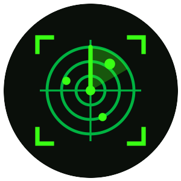

<p align="center"></p>

# MeshWardrive

[English](README.md) · **Español**

App Android para mapear la cobertura de una red **Meshtastic** mientras te mueves (*wardriving*), al estilo de MeshMapper para MeshCore.

**Autor:** EB7BWD

<p align="center">
  
  
  
  
  
  
</p>

## Descargar

Descarga el APK desde **[Releases](../../releases/latest)** e instálalo (Android 8 o posterior). Es la **única** fuente oficial: no instales copias de otras webs, porque no puedes saber si las han modificado. Todas las versiones van firmadas con la misma clave, así que se actualizan una encima de otra sin perder datos.

## ⚠️ Aviso importante

MeshWardrive es una aplicación **experimental**, creada por EB7BWD y desarrollada **casi en su totalidad por una inteligencia artificial** (Claude, de Anthropic). El código no ha sido auditado y puede contener errores.

Se ofrece **«tal cual», sin garantía de ningún tipo**, expresa o implícita, incluidas las de funcionamiento, exactitud de los datos o adecuación a un fin concreto.

Al usarla aceptas que:

- La usas **bajo tu exclusiva responsabilidad**.
- Eres responsable de cumplir la normativa aplicable en tu país: uso del espectro radioeléctrico, ciclo de trabajo y potencia, protección de datos y tráfico.
- Cada ping ocupa tiempo de aire de una red compartida. Es tu responsabilidad configurarla de forma respetuosa y no saturar la malla.
- No debes manipular el móvil mientras conduces.
- Los mapas de cobertura son orientativos y no deben usarse para comunicaciones de emergencia o de seguridad.

En la máxima medida permitida por la ley, **el autor no se hace responsable** de ningún daño, perjuicio, sanción, pérdida de datos o mal uso derivado de esta aplicación.

Si no estás de acuerdo, no la uses. La app muestra este mismo aviso en el primer arranque y hay que aceptarlo para continuar.

## Privacidad

**MeshWardrive no recopila ningún dato.** No tiene servidores ni cuentas, no incluye analíticas ni publicidad y no envía nada al autor ni a terceros. Tus mediciones se quedan en tu teléfono y solo salen de él si tú las exportas o las compartes.

Lo que sí sale del teléfono:

- **Los pings**, que se emiten por radio. Cualquiera que tenga el canal puede leerlos, incluidas tus coordenadas si activas «Incluir coordenadas en el mensaje» (desactivado por defecto).
- **Con el mapa online**, los servidores de OpenStreetMap reciben tu dirección IP y la zona que estás viendo, como con cualquier mapa web. Con un mapa offline, no.
- **Si descargas el relieve** en el Mapa de cobertura, el servidor de *Terrain Tiles* (Amazon Web Services) recibe tu IP y la zona que pides. Solo ocurre al pulsar el botón; tu posición no se envía.

Los datos de otros nodos (nombres, posiciones, retransmisiones) llegan por radio y no se pueden verificar: cualquiera puede falsearlos. Este aviso está también en la app, en **Ajustes → Acerca de**.

## Qué hace

- Se conecta por Bluetooth a tu nodo Meshtastic.
- Envía pings periódicos con ACK a un canal (por defecto `wardriving`).
- De cada ping guarda la posición GPS, si alguien lo oyó, qué nodo lo retransmitió y el SNR/RSSI.
- Registra también todo lo que tu nodo oye por radio, con tu posición.
- Lo pinta en un mapa de calor: verde donde hay cobertura, rojo donde no.
- Antes de cada salida pregunta cómo llevas el nodo (bolsillo, coche, techo…) y usa esas condiciones para no dar por «sin cobertura» una zona solo porque el nodo iba mal colocado.
- Marca dónde ha aparecido cobertura nueva (▲) o se ha perdido (▼) sin borrar el historial.
- Tiene una pantalla de consulta, **Mapa de cobertura**, con mapa de calor sin puntos, una estimación de las zonas aún sin medir (que puede tener en cuenta el relieve) y una ficha de cada celda.
- Lista los nodos que probablemente te han repetido.
- Dibuja el ruido de fondo estimado a lo largo de la ruta; toca un punto para verlo en el mapa.
- Dibuja la ruta recorrida y señala los huecos sin medir cerca de ti.
- Guarda cada wardrive por separado: puedes ver uno, varios combinados, todos, solo el último o los de unas fechas, y renombrarlos o borrarlos.
- Permite borrar mediciones concretas del mapa (un ping, una celda o una zona), con opción de deshacer.
- Hace un informe de cada salida y compara dos wardrives para ver dónde mejoró o empeoró la cobertura.
- Comparte wardrives con amigos en un archivo `.mwd` que ellos importan en su app.
- Funciona sin Internet con mapas offline.
- Exporta el resultado como imagen y en formatos para hacer mapas de cobertura.

Además del modo normal (canal) tiene un **modo directo**, en el que el ping va a un nodo concreto y se registra su confirmación, y un **modo solo escucha**, que no emite nada y solo registra lo que oye tu nodo.

## Pantallas

Cinco pestañas que se cambian deslizando o con la barra inferior: **Mapa**, **Conexión**, **Datos**, **Registro** y **Ajustes**. Sobre el mapa, deslizar mueve el mapa; de esa pestaña se sale con la barra inferior.

- **Mapa:** la tarjeta de arriba resume la conexión, el GPS y el último ping; tócala para plegarla. Si un ping no sale, ahí aparece el motivo. Debajo están **Iniciar/Parar**, **Ping** y **Capas**, y una leyenda; **toca la leyenda** para ver qué significa cada color. **Toca un ping** para ver su detalle y **mantén pulsado** el mapa para ver la ficha de esa celda o borrar mediciones.
- **Datos** tiene tres apartados: **Wardrives** (elegir cuáles se ven, solo el último, filtro de fechas, renombrar, condiciones, compartir, importar, borrar), **Análisis** (mapa de cobertura, resumen, informe, comparar, gráfica de ruido, repetidores) y **Exportar** (imagen, archivos de cobertura, mapas offline).
- **Ajustes** está ordenado por temas: Ping, Medición, Mapa, Conexión, Privacidad e Idioma. Cada número lleva debajo una línea que explica para qué sirve.

**Modo nocturno.** En **Ajustes → Mapa → Tema** puedes elegir claro, oscuro o como el teléfono (por defecto). En oscuro también se oscurece el mapa; las imágenes que exportas siguen saliendo en claro.

La primera vez se muestra un tutorial que se puede saltar; se puede volver a ver desde **Ajustes**.

## Idiomas

Inglés, español, francés, italiano, portugués, alemán, ruso, árabe, griego y japonés. Por defecto sigue el idioma del teléfono (y si no está entre estos, usa inglés). Se puede cambiar en **Ajustes → Idioma**. Las traducciones son automáticas y se agradecen correcciones.

## El canal `wardriving`: una propuesta de estándar

La idea del proyecto es que todo el mundo use **el mismo canal** para hacer wardriving, de modo que los pings de distintas personas sean comparables y cualquiera pueda verlos y registrarlos:

- **Nombre:** `wardriving`
- **Clave (PSK):** `AQ==`

`AQ==` es la clave pública por defecto de Meshtastic. Como la conoce todo el mundo, el canal va en la práctica **sin cifrar**: cualquiera que lo añada puede leer los pings, incluidas tus coordenadas si activas «Incluir coordenadas en el mensaje».

Es una propuesta, no una obligación. **La elección es en última instancia tuya:** puedes usar una clave privada para que solo tu grupo vea los pings, o un nombre de canal distinto (se cambia en **Ajustes**). La app funciona igual en cualquier caso.

## Cómo usarla

1. Crea en tu nodo un canal secundario llamado `wardriving` con clave `AQ==` usando la app oficial de Meshtastic (ver arriba).
2. Cierra la app oficial (el nodo solo admite una conexión Bluetooth).
3. Abre MeshWardrive, acepta el aviso, ve a **Conexión**, pulsa **Buscar y conectar** y elige tu nodo.
4. En **Mapa**, pulsa **Iniciar** y muévete.

Si la conexión falla, el motivo aparece en **Conexión** y en **Registro**. Para parar sin abrir la app, usa el botón **Parar** de la notificación.

## Opciones

Las funciones que cambian cuándo se envían los pings están en **Ajustes** y vienen **desactivadas** por defecto, para que la app se comporte como siempre hasta que tú decidas. Cada opción lleva debajo una línea que explica qué hace.

| Opción | Dónde | Qué hace |
|---|---|---|
| Espera de la respuesta | Ajustes → Ping | Segundos que se espera a que alguien oiga el ping (**30** por defecto; antes 90). Si la respuesta llega cuando ya te has movido más de 75 m, el acierto se coloca donde llegó y no donde se envió, para que no aparezca una celda verde donde en realidad no había cobertura. |
| Ping según la velocidad (SmartBeaconing™) | Ajustes → Ping | Usa el algoritmo SmartBeaconing™ de Tony Arnerich (KD7TA) y Steve Bragg (KA9MVA), del proyecto HamHUD, el mismo que APRSdroid y muchas radios APRS: parado o despacio pingea cada «intervalo lento» (120 s); por encima de la «velocidad alta» (90 km/h), cada «intervalo rápido» (15 s); entre medias, de forma proporcional, para que los pings queden repartidos por la ruta. Al girar más del ángulo indicado manda uno extra. Sustituye al intervalo fijo y nunca baja de 15 s. Desactivado por defecto. |
| Criterio para dar un ping por bueno o malo | Ajustes → Medición | **Ponderado** (por defecto) o **clásico**. Se explica en [Condiciones y criterio](#condiciones-del-wardrive-y-criterio-de-valoración). |
| Preguntar las condiciones al empezar | Ajustes → Medición | **Activado** por defecto. Al pulsar Iniciar aparece una hoja corta con cómo llevas el nodo, ya rellena con lo de la última vez. Se puede marcar «No volver a preguntar». |
| Modo solo escucha | Ajustes → Ping → Modo (o el botón de destino en **Conexión**) | No envía pings. Registra todo lo que oye tu nodo con tu posición. Útil para medir sin ocupar tiempo de aire. |
| Texto del ping | Ajustes → Ping | La palabra que va delante del número (por defecto `WD`, de *wardrive*). Hasta 10 letras, números o `-_#!*+.`. |
| Guardar todo lo que oye el nodo | Ajustes → Medición | **Activado** por defecto. Si lo desactivas, además de los pings solo se guarda lo dirigido a ti (ACK y respuestas): ocupa mucho menos, pero la gráfica de ruido y la lista de nodos al alcance tienen menos datos. El modo solo escucha siempre lo guarda todo. |
| Ping inteligente | Ajustes → Medición | Solo envía pings en celdas que aún no tienen suficientes mediciones **con respuesta** (3 por defecto); los fallos no cuentan, así una celda sin cobertura se vuelve a probar en otra salida. Ahorra tiempo de aire al repetir rutas. Tiene dos ajustes más: **intentos sin respuesta por celda en cada salida** (3; para no insistir sin fin en una zona muerta, 0 = sin límite) y **distancia mínima entre mediciones de una celda** (0 = desactivada; reparte las mediciones en vez de amontonarlas en un semáforo). |
| Pausa si el canal está saturado | Ajustes → Medición | Si el nodo informa de una ocupación del canal por encima del umbral (25 % por defecto), deja de enviar pings hasta que baje. La ocupación actual se ve en la tarjeta del mapa. |
| GPS del nodo | Ajustes → Medición | Si tu nodo tiene GPS, usa su posición cuando la del móvil falta o no es lo bastante precisa. La antigüedad se calcula con la hora del propio fix (no con la de llegada) y se aceptan posiciones de hasta 1 minuto. Si el canal recorta la precisión (*precision bits*), ese error se suma. En **Registro** se ve cada posición que llega del nodo con su precisión y antigüedad, o el motivo por el que no se usa. Ver [Configurar el GPS del nodo](#configurar-el-gps-del-nodo). |
| Dejar de reconectar | Ajustes → Conexión | Si el nodo lleva desconectado más de esos minutos (10 por defecto), para el wardrive y avisa con una notificación. 0 = no rendirse nunca. |
| Tema | Ajustes → Mapa | Como el teléfono (por defecto), claro u oscuro (nocturno). |
| Tu nombre al compartir | Ajustes → Privacidad | El nombre que aparece en los archivos `.mwd`. Si lo dejas vacío, se usa el de tu nodo. |

En **Capas** (pestaña Mapa) puedes encender o apagar el mapa de calor, las celdas, los pings, la recepción pasiva, los nodos, la **ruta recorrida**, los **huecos cercanos** (celdas vecinas sin medir, para saber hacia dónde ir) y los **cambios de cobertura** (▲ ▼). Desde ese mismo diálogo se abre el **Mapa de cobertura**.

## Condiciones del wardrive y criterio de valoración

No es lo mismo no recibir respuesta con el nodo en el bolsillo que con una antena en el techo del coche. Por eso, al pulsar **Iniciar**, la app pregunta en una hoja corta:

- **Dónde va el nodo:** bolsillo, mochila, en la mano, dentro del coche, salpicadero, techo del coche o mástil.
- **Antena externa** y su ganancia (dBi).
- **Potencia de emisión** (dBm). Si el nodo la informa, se rellena sola.
- **Cómo te mueves:** a pie, en bici o en coche.

Con eso calcula una **dificultad** (fácil, normal o difícil), que se ve en la misma hoja mientras la rellenas, y una **fiabilidad** para los fallos de esa salida. Las condiciones se guardan con cada wardrive, se pueden corregir después (**Datos → Wardrives →** toca un wardrive **→ Condiciones…**) y viajan en el archivo `.mwd`. Los wardrives antiguos, sin condiciones, se tratan como de fiabilidad media y se ven igual que antes.

**Criterio ponderado** (por defecto, en **Ajustes → Medición**):
- Una respuesta siempre demuestra que hay cobertura.
- Un fallo solo cuenta como «sin cobertura» si las condiciones eran razonables. Los fallos en condiciones difíciles se pintan en **gris azulado** («sin confirmar») y no tapan nada.
- Cada celda toma el estado de su **última salida con datos concluyentes**. Si antes no había cobertura y ahora sí, se marca con **▲**; si antes había y ahora no, con **▼**. El historial no se borra: los fallos antiguos de una zona que ahora tiene cobertura se ven como **puntos huecos**.

**Criterio clásico:** cada ping cuenta igual, como en versiones anteriores. La celda es verde si alguna vez tuvo respuesta y roja si nunca.

## Mapa de cobertura y estimación

**Datos → Análisis → Mapa de cobertura** (o desde **Capas**) abre una pantalla de consulta, pensada para mirar la cobertura y no para medir:

- **Medido:** mapa de calor sin puntos, con los mismos colores del mapa principal.
- **Estimación (rayada):** donde no has medido, la app estima la cobertura a partir de las celdas medidas cercanas (hasta 2 km). Va siempre rayada para no confundirla con datos reales, y las celdas con poca confianza no se pintan.
- **Relieve:** el botón **Relieve** descarga la elevación del terreno de la zona visible (datos abiertos *Terrain Tiles*, unos 30 m por píxel; como máximo 80 teselas por descarga) y después funciona sin conexión. Con el relieve, la estimación comprueba si una loma tapa la vista a los nodos que te oyeron: si la vista está despejada sube la probabilidad y, si está tapada, la reduce a la mitad.
- **Ficha de celda:** toca cualquier celda para ver si es medida o estimada, su estado, el rango de SNR, cuándo se midió por primera y última vez (y si los datos son antiguos), la fiabilidad de las mediciones, la altitud media del GPS, la elevación del terreno y qué nodos te oyeron o repitieron allí.
- **Imagen:** exporta lo que ves como PNG.

La estimación es orientativa: no tiene en cuenta edificios ni vegetación, y la altura de las antenas se supone (1,5 m tú, 5 m el nodo).

## Borrar mediciones

A veces una medición está mal: el nodo iba en la guantera, el GPS dio un salto, o se hizo una prueba en casa. Para quitarla sin borrar todo el wardrive:

- **Un ping:** tócalo en el mapa y pulsa **Borrar esta medición**.
- **Una celda:** mantén pulsado sobre ella; se abre su ficha. Pulsa **Borrar… → Mediciones de esta celda**.
- **Una zona:** mantén pulsado en una esquina, pulsa **Borrar… → Una zona: esta es una esquina** y después mantén pulsado en la esquina opuesta. Antes de borrar se muestra cuántas mediciones hay dentro.

Solo se borra lo de los wardrives que se están mostrando.

Al borrar aparece un aviso con **Deshacer** durante unos segundos; hasta que desaparece no se borra nada de verdad.

## Ver por fechas

En **Datos → Wardrives**:
- El botón **Fechas** permite ver todo, todo **hasta** una fecha, o solo un **intervalo**. Cuando hay un filtro de fechas activo se indica arriba del mapa; toca la ✕ para quitarlo.
- Al elegir qué wardrives se muestran, el botón **Solo el último** desmarca todos los demás de una vez.

## Pings que no salen y ciclo de trabajo

Si es **tu propio nodo** el que no llega a emitir el ping (por ejemplo, porque ha agotado el **ciclo de trabajo** permitido en la banda, error `DUTY_CYCLE_LIMIT`), la app lo marca como **no enviado** en gris. No cuenta como «sin cobertura», porque nadie tuvo ocasión de oírlo. Si el motivo es el ciclo de trabajo, los pings automáticos se pausan 5 minutos y la tarjeta del mapa dice hasta qué hora.

En Europa (868 MHz) el límite habitual es del 10 % del tiempo por hora en la subbanda que usa Meshtastic. Con intervalos de 30 s o más y pocos saltos no se suele alcanzar, pero con presets lentos sí es posible.

## Rol del nodo

Si conectas un nodo con rol de **repetidor** (ROUTER, ROUTER_LATE, REPEATER…), la app lo avisa en **Conexión** y en **Registro**: un nodo que va contigo repitiendo tráfico ocupa tiempo de aire de la malla y puede falsear la medición. Para hacer wardriving se recomienda el rol **CLIENT_MUTE** (el nodo envía y recibe, pero no repite nada) o **CLIENT**. Se cambia con la app oficial de Meshtastic, en *Configuración → Dispositivo → Rol*.

## Configurar el GPS del nodo

Muchos rastreadores con GPS (por ejemplo, un RAK WisMesh Tag) envían su posición con poca frecuencia y a veces sin precisión, así que la app puede no aceptarla. En la app oficial de Meshtastic, en *Configuración → Posición*:

- **Intervalo de actualización del GPS** (*GPS update interval*): por defecto 2 minutos. Bájalo a 10–30 s mientras haces wardriving (gasta más batería).
- **Emisión inteligente de posición** (*Smart broadcast*): actívala, con una distancia mínima pequeña (por ejemplo 50–100 m) y un intervalo mínimo corto.
- **Precisión de la posición en el canal** (*precision bits*): si el canal por el que llega la posición la recorta, la app no puede saber dónde estás con más detalle que eso. Con 32 bits va completa; con valores bajos el error es de cientos de metros o kilómetros, y la app la descartará si supera la precisión mínima.

Si el nodo no informa de precisión, la app la marca como **desconocida** (±?) y la usa igual que las demás: solo cuando la del móvil falta o no es lo bastante precisa. En **Registro** aparece cada posición del nodo y por qué se ha usado o no.

## Espacio y copias de seguridad

Los pings y la ruta ocupan muy poco y no tienen límite. Lo que sí puede crecer mucho es la **recepción pasiva** (todo lo que oye tu nodo): en una malla con tráfico son miles de paquetes por salida, y con el modo solo escucha encendido muchas horas se llena antes. Por eso la app guarda como máximo **300 000 paquetes** (unas decenas de MB); al llegar ahí borra los más antiguos.

Antes de que eso pase, avisa:
- En **Datos → Wardrives** se ve siempre cuántas recepciones hay guardadas y el porcentaje del límite.
- Al llegar al **80 %** y al **95 %**, la app muestra un aviso (y una notificación si estás haciendo un wardrive) con tres opciones: gestionar los wardrives, dejar de guardar lo pasivo o recordártelo más tarde.
- Al importar un `.mwd` que haría pasar del límite, el resumen te dice cuántas recepciones antiguas se borrarían, antes de aceptar.

Para hacer una **copia de seguridad**, comparte tus wardrives como `.mwd` y guarda el archivo (en Drive, en tu ordenador…). Desmarca «Recortar 1 km» para que la copia esté completa. Después puedes borrar esos wardrives del móvil y volver a importarlos cuando quieras.

## Gestionar y compartir wardrives

En **Datos → Wardrives** toca cualquier wardrive para verlo solo en el mapa, renombrarlo, compartirlo o borrarlo. Con las casillas eliges cuáles se muestran a la vez.

**Compartir.** **Compartir wardrives…** genera un archivo `.mwd` con los wardrives que elijas y abre el menú de compartir de Android. Antes te deja:
- **Recortar 1 km al principio y al final** (activado por defecto), porque suelen ser tu casa o tu trabajo.
- **Quitar las coordenadas del texto de los pings.**

El archivo contiene tu recorrido con horas: revisa qué compartes y con quién.

**Importar.** Abre el `.mwd` con MeshWardrive (desde el chat o el gestor de archivos) o usa **Importar wardrive…**. Antes de importar se muestra un resumen. El importador está hecho para no confiar en el archivo: limita su tamaño, solo acepta los campos conocidos con valores dentro de rango, descarta lo que no cuadra y rechaza el archivo entero si hay demasiado basura. El texto importado nunca se interpreta como código ni como fórmula. Los wardrives importados aparecen con el nombre de quien los compartió y se pueden ver, comparar o borrar como los tuyos.

## Analizar

En **Datos → Análisis**:

- **Informe:** distancia, duración, pings y porcentaje con respuesta, celdas medidas y con cobertura, y la mejor y peor zona (tócalas para ir al mapa). **Compartir imagen** genera una imagen con el mapa y el resumen.
- **Comparar:** elige un grupo de wardrives «antes» y otro «después». El mapa colorea cada celda según haya mejorado, empeorado, seguido igual, sea nueva o solo se midiera antes. Sirve para ver el efecto de un repetidor nuevo o de cambiar una antena. Una celda cuenta como cambio si el porcentaje de éxito varía 15 puntos o el mejor SNR 3 dB.
- **Gráfica de ruido:** toca un punto para ver la hora, el ruido, el RSSI, el SNR y el estado; toca el recuadro para verlo en el mapa. Pellizca para ampliar y toca dos veces para volver. Con varios wardrives se dibujan seguidos, separados por una línea discontinua.
- **Repetidores:** toca uno para verlo en el mapa o para ver **solo su cobertura** (los pings que repitió) y su alcance máximo.
- **Cómo se calcula cada valor:** la misma explicación que hay más abajo, dentro de la app.

## Cómo se calcula cada valor

**Pings**

| Valor | Cómo se obtiene |
|---|---|
| Oído por la malla | Tu nodo oyó a un vecino retransmitir el ping (el ACK implícito de Meshtastic). |
| ACK del destino | Solo en modo directo: el nodo destino devolvió una confirmación real. |
| Rechazado / sin oyentes | El nodo informó de un error. El habitual es `MAX_RETRANSMIT`: reintentó y nadie retransmitió. |
| Sin respuesta | No llegó nada dentro de la espera máxima (30 s por defecto). |
| No enviado | Tu propio nodo no llegó a emitir el ping (ciclo de trabajo agotado, cola llena, sin canal…). No cuenta en ningún porcentaje ni como «sin cobertura». |
| Respuesta tardía | Si la respuesta llega cuando estás a más de 75 m de donde se envió el ping, el acierto se coloca donde llegó. En la ficha del ping se indica. |
| Relay | El campo `relay_node` de la confirmación: el último byte del ID del nodo que retransmitió. La app lista todos los nodos conocidos cuyo ID acaba en ese byte. |
| SNR / RSSI del relay | Los mide **tu** nodo al oír esa retransmisión. Describen el camino del relay hacia ti, no lo bien que te oyó el relay. |
| SNR / RSSI del ACK | Modo directo: los mide tu nodo en el último salto de la confirmación. |
| Saltos | `hop_start − hop_limit` del paquete recibido. |
| Latencia | Tiempo entre enviar el ping y recibir su respuesta. |
| % de éxito | Con respuesta ÷ (con respuesta + sin respuesta). Los pings en espera y los no enviados no cuentan. |

Un ping se envía solo de forma automática cuando ha pasado el intervalo mínimo (o el que marque el ping según la velocidad), te has movido la distancia mínima, la posición GPS es reciente y lo bastante precisa, y el ping anterior ha terminado. El hop limit por defecto es 1: solo lo retransmiten los vecinos directos.

**Mapa**

| Valor | Cómo se obtiene |
|---|---|
| Color | Según el SNR: verde ≥ −7 dB, ámbar de −7 a −13 dB, naranja por debajo de −13 dB. Rojo es sin respuesta. Un ping oído sin dato de SNR sale verde. |
| Mapa de calor | Una mancha difuminada por ping, de su color, con radio igual al tamaño de celda (nunca menor que la yema de un dedo en pantalla). Primero se pintan los fallos y encima los aciertos. |
| Celdas | Rejilla de cuadrados del tamaño configurado (150 m por defecto). Si la celda tiene cobertura, el color es el del **mejor** SNR entre los pings con respuesta. Con el criterio ponderado, el estado (cobertura, sin cobertura o sin confirmar) lo decide la última salida con datos concluyentes; con el clásico, es verde si alguna vez hubo respuesta y rojo si nunca. |
| Dificultad de las condiciones | dB respecto a la referencia (antena de serie de 2 dBi fuera del vehículo, 22 dBm): bolsillo −15, mochila −10, en la mano −3, dentro del coche −8, salpicadero −5, techo 0, mástil +3; más la ganancia de la antena externa − 2 y la potencia − 22. Desde −3 es fácil (fiabilidad alta), desde −10 normal (media) y por debajo difícil (baja). |
| Sin confirmar | Celda con solo fallos de fiabilidad baja. Solo con el criterio ponderado. |
| ▲ / ▼ | ▲: la última salida concluyente tuvo respuesta y alguna anterior solo fallos. ▼: la última no tuvo respuesta y alguna anterior sí. |
| SNR medio de la celda | Media aritmética del SNR de los pings con respuesta de la celda. |
| Recepción pasiva | Cada paquete que tu nodo recibe por radio (no por MQTT), guardado con tu posición en ese momento si la posición GPS tiene menos de 15 s. |

**Análisis**

| Valor | Cómo se obtiene |
|---|---|
| Ruido de fondo | Meshtastic no lo informa, así que es una estimación con cada paquete oído: `RSSI − SNR` si el SNR es positivo, y el propio `RSSI` si el SNR es negativo (la señal queda entonces por debajo del ruido). Los paquetes con SNR por encima de 5 dB se descartan, porque el SNR de LoRa se satura y la resta daría un ruido falso, mucho más alto. Solo hay valores donde se recibió algo. |
| Pings en la gráfica | Se colocan en el instante de cada ping, sobre la línea de ruido (interpolada entre las muestras más cercanas). |
| Repetidores probables | Si el firmware informa de quién repitió cada ping, pings agrupados por byte de relay. Muchas versiones de firmware no lo informan; entonces la lista muestra los nodos al alcance: los oídos directamente (con su ID completo) y los vistos repitiendo tráfico ajeno. «Paquetes ajenos» cuenta el tráfico de terceros que te llegó a través de ese mismo byte. El mejor SNR y el SNR medio salen de esas recepciones. |
| Posición del repetidor en el mapa | La del propio nodo si coincide exactamente un nodo conocido y ha compartido su posición; si no, el lugar donde mejor se oyó. |
| Estimación | Media de las celdas medidas a menos de 2 km, pesada por la inversa de la distancia (cobertura 1 / 0,8 / 0,6 según el SNR; sin cobertura 0). La confianza baja con la distancia a la celda medida más cercana y sube con el número de vecinas; por debajo del 30 % no se pinta. Probable desde 60 %, dudosa desde 35 %. |
| Relieve | Línea de visión desde la celda (1,5 m sobre el suelo) hasta cada nodo con posición que te oyó (5 m), teniendo en cuenta la curvatura de la Tierra y una parte de la zona de Fresnel. Despejada: +20 puntos; tapada: la estimación se reduce a la mitad. |

## Mapas offline

Los servidores de OpenStreetMap no permiten descargar zonas para uso sin conexión, así que la app usa mapas vectoriales de Mapsforge, que sí están pensados para eso:

1. Descarga el archivo `.map` de tu zona, por ejemplo desde <https://download.mapsforge.org/>.
2. En **Datos → Exportar → Mapa offline… → Importar mapa**, elige el archivo.
3. La app lo copia y pasa a usarlo. Desde el mismo menú puedes volver al mapa online o borrarlo.

## Exportar

Desde la pestaña **Datos**:

| Formato | Para qué |
|---|---|
| Imagen PNG | El mapa tal y como se ve, con leyenda y resumen. Para compartir. |
| Celdas GeoJSON | Polígonos de cobertura con estadísticas y color. Para QGIS, uMap, geojson.io. |
| KML | Celdas, pings y nodos en carpetas. Para Google Earth y OsmAnd. |
| Puntos GeoJSON | Cada ping y cada paquete oído, con todos sus datos. |
| CSV | Pings y recepción pasiva en tablas. Para hojas de cálculo. |

### Cómo usar cada exportación

Las exportaciones están en **Datos → Exportar** e incluyen solo los wardrives que se están mostrando. Contienen tu recorrido: revísalas antes de compartirlas. Para pasar wardrives a otra persona que use MeshWardrive es mejor el archivo `.mwd` (ver arriba).

**Imagen PNG.** Una foto del mapa tal como lo ves en ese momento, así que ajusta antes el zoom y las capas. Sirve para compartir por chat o redes, o para pegar en un documento.

**Celdas GeoJSON** (`coverage-cells-….geojson`). El mapa de cobertura listo para publicar.
- *geojson.io*: abre la web y arrastra el archivo sobre el mapa. Las celdas salen ya coloreadas.
- *uMap*: crea un mapa, pulsa **Importar datos** y elige el archivo. Útil para tener un mapa online que compartir.
- *QGIS*: arrastra el archivo a la ventana. Coloréalo por el campo `class` (`good`, `marginal`, `weak`, `no_coverage`, `unconfirmed`) o por `success_pct`.
- Campos de cada celda: `pings`, `ok`, `fail`, `unconfirmed_fail`, `success_pct`, `best_snr`, `avg_snr`, `trend` (`new_coverage`, `lost_coverage`), `first` y `last` (fechas de la primera y última medición). Las celdas con `layer` = `rx` son de recepción pasiva.

**KML** (`coverage-….kml`). Para verlo en un globo o en una app de navegación.
- *Google Earth*: en el ordenador, **Archivo → Importar archivo KML**; en el móvil, abre el archivo con Google Earth.
- *OsmAnd*: abre el archivo con OsmAnd, o impórtalo como favorito o traza.
- Trae cuatro carpetas que se pueden activar y desactivar: celdas de cobertura, pings, recepción pasiva y nodos. Toca cualquier elemento para ver su detalle.

**Puntos GeoJSON** (`wardrive-….geojson`). Cada medición por separado, para tu propio análisis.
- *QGIS* o *kepler.gl*: carga el archivo y colorea los puntos por `status`, `relay_snr` o `snr`.
- El campo `kind` separa los pings (`ping`) de los paquetes oídos (`rx`).
- Úsalo si quieres otra rejilla o tu propio mapa de calor.

**CSV** (`wardrive-pings-….csv` y `wardrive-rx-….csv`). Tablas para hojas de cálculo y scripts.
- Ábrelos con LibreOffice Calc o Excel (separador coma, UTF-8).
- Pings: una fila por ping, con hora, posición, estado, error, latencia, relay y SNR/RSSI.
- Recepción pasiva: una fila por paquete oído, con nodo de origen, puerto, SNR, RSSI, saltos y relay.

## Compilar

Solo hace falta si quieres modificar la app; para usarla, descarga el APK de **Releases**.

Con Android Studio o en local:

```bash
./gradlew assembleDebug
```

Con GitHub Actions, cada *push* genera el APK firmado, que se descarga en **Actions → Artifacts**, y cada etiqueta `v*` (por ejemplo `v0.7.0`) publica además una release con el APK y las notas de `docs/release-notes/<etiqueta>.md`. La firma usa dos secretos del repositorio, `KEYSTORE_BASE64` (el almacén de claves en base64) y `KEYSTORE_PASSWORD`, con el alias `meshwardrive`. La clave nunca debe subirse al repositorio.

## Tiempo de aire

Mantén un intervalo de 30 s o más y un `hop_limit` bajo. El ping inteligente y el ping según la velocidad ayudan a no gastar tiempo de aire donde ya hay datos o mientras estás parado.

## Apoyar el proyecto

MeshWardrive es gratis, sin anuncios y lo seguirá siendo. Si te resulta útil y quieres echar una mano con los gastos, puedes invitar a un café en Ko-fi:

[](https://ko-fi.com/eb7bwd)

Es totalmente voluntario: la app no tiene ninguna función de pago ni la tendrá. También ayuda mucho avisar de fallos, proponer mejoras o revisar las traducciones.

## Licencia

Copyright © 2026 EB7BWD

Software libre bajo la [GNU General Public License v3.0](LICENSE) o posterior. Puedes usarlo, modificarlo y redistribuirlo, siempre que las versiones derivadas sigan siendo libres bajo la misma licencia. Se distribuye **sin ninguna garantía**.

## Créditos

- Idea y proyecto: **EB7BWD**
- Código generado casi en su totalidad con IA (Claude, de Anthropic)
- Mapas © colaboradores de OpenStreetMap
- Relieve: Terrain Tiles (AWS Open Data; fuentes SRTM, NED, ETOPO1 y otras)
- Ping según la velocidad: algoritmo SmartBeaconing™, creado por Tony Arnerich (KD7TA) y Steve Bragg (KA9MVA) para el proyecto HamHUD. SmartBeaconing es una marca de HamHUD Nichetronix.
- osmdroid, AndroidX, Material Components y kotlinx.coroutines (Apache 2.0); Mapsforge (LGPL v3)

Proyecto independiente, sin relación con Meshtastic, MeshMapper ni HamHUD Nichetronix. Meshtastic® es una marca registrada de Meshtastic LLC. SmartBeaconing™ es una marca de HamHUD Nichetronix.
