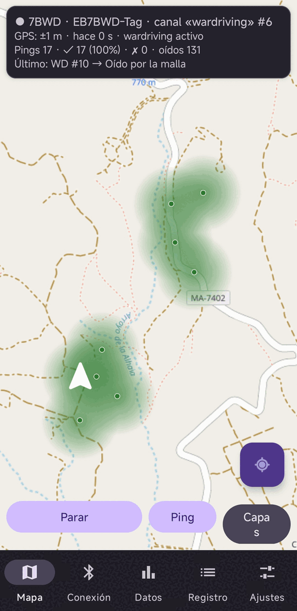
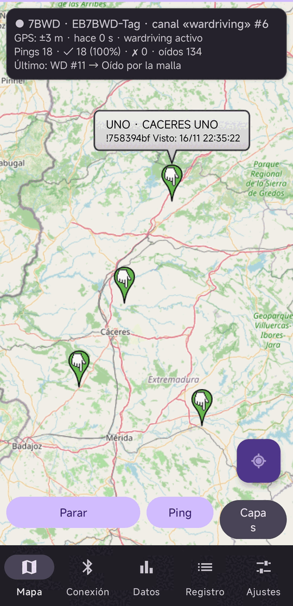
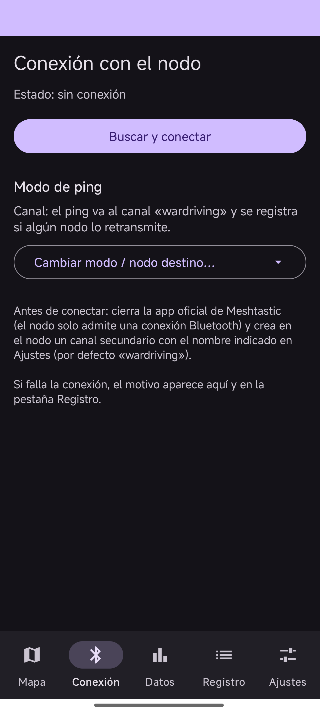
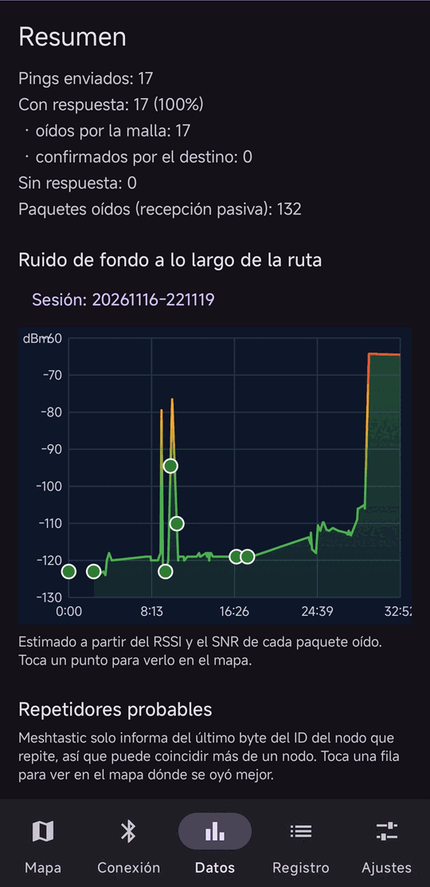
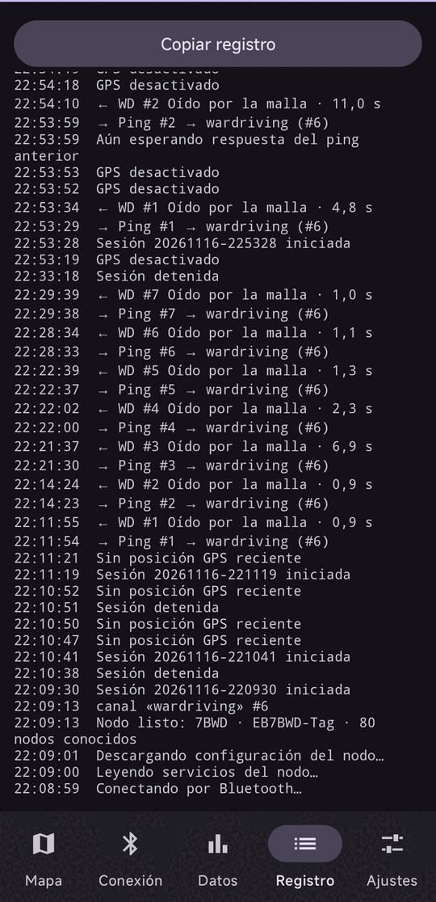
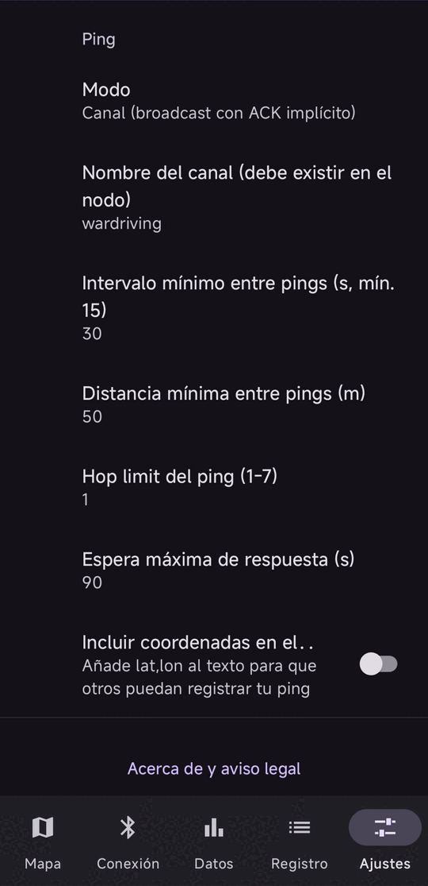

<p align="center"></p>

# MeshWardrive

[English](README.md) · **Español**

App Android para mapear la cobertura de una red **Meshtastic** mientras te mueves (*wardriving*), al estilo de MeshMapper para MeshCore.

**Autor:** EB7BWD

<p align="center">
  
  
  
  
  
  
</p>

## ⚠️ Aviso importante

MeshWardrive es una aplicación **experimental**, creada por EB7BWD y desarrollada **casi en su totalidad por una inteligencia artificial** (Claude, de Anthropic). El código no ha sido auditado y puede contener errores.

Se ofrece **«tal cual», sin garantía de ningún tipo**, expresa o implícita, incluidas las de funcionamiento, exactitud de los datos o adecuación a un fin concreto.

Al usarla aceptas que:

- La usas **bajo tu exclusiva responsabilidad**.
- Eres responsable de cumplir la normativa aplicable en tu país: uso del espectro radioeléctrico, ciclo de trabajo y potencia, protección de datos y tráfico.
- Cada ping ocupa tiempo de aire de una red compartida. Es tu responsabilidad configurarla de forma respetuosa y no saturar la malla.
- No debes manipular el móvil mientras conduces.
- Los mapas de cobertura son orientativos y no deben usarse para comunicaciones de emergencia o de seguridad.

En la máxima medida permitida por la ley, **el autor no se hace responsable** de ningún daño, perjuicio, sanción, pérdida de datos o mal uso derivado de esta aplicación.

Si no estás de acuerdo, no la uses. La app muestra este mismo aviso en el primer arranque y hay que aceptarlo para continuar.

## Qué hace

- Se conecta por Bluetooth a tu nodo Meshtastic.
- Envía pings periódicos con ACK a un canal (por defecto `wardriving`).
- De cada ping guarda la posición GPS, si alguien lo oyó, qué nodo lo retransmitió y el SNR/RSSI.
- Registra también todo lo que tu nodo oye por radio, con tu posición.
- Lo pinta en un mapa de calor: verde donde hay cobertura, rojo donde no.
- Lista los nodos que probablemente te han repetido.
- Dibuja el ruido de fondo estimado a lo largo de la ruta; toca un punto para verlo en el mapa.
- Guarda cada wardrive por separado: puedes ver uno, varios combinados o todos.
- Funciona sin Internet con mapas offline.
- Exporta el resultado como imagen y en formatos para hacer mapas de cobertura.

Tiene además un modo directo opcional: el ping va a un nodo concreto y se registra su confirmación.

## Pantallas

Cinco pestañas que se cambian deslizando o con la barra inferior: **Mapa**, **Conexión**, **Datos**, **Registro** y **Ajustes**. Sobre el mapa, deslizar mueve el mapa; de esa pestaña se sale con la barra inferior.

## Idiomas

Inglés, español, francés, italiano, portugués, alemán, ruso, árabe, griego y japonés. La app sigue el idioma del teléfono; en Android 13 o posterior también se puede elegir por aplicación en los ajustes del sistema. Las traducciones son automáticas y se agradecen correcciones.

## El canal `wardriving`: una propuesta de estándar

La idea del proyecto es que todo el mundo use **el mismo canal** para hacer wardriving, de modo que los pings de distintas personas sean comparables y cualquiera pueda verlos y registrarlos:

- **Nombre:** `wardriving`
- **Clave (PSK):** `AQ==`

`AQ==` es la clave pública por defecto de Meshtastic, la misma que usa el canal LongFast estándar. Como la conoce todo el mundo, el canal va en la práctica **sin cifrar**: cualquiera que lo añada puede leer los pings, incluidas tus coordenadas si activas «Incluir coordenadas en el mensaje».

Es una propuesta, no una obligación. **La elección es en última instancia tuya:** puedes usar una clave privada para que solo tu grupo vea los pings, o un nombre de canal distinto (se cambia en **Ajustes**). La app funciona igual en cualquier caso.

## Cómo usarla

1. Crea en tu nodo un canal secundario llamado `wardriving` con clave `AQ==` usando la app oficial de Meshtastic (ver arriba).
2. Cierra la app oficial (el nodo solo admite una conexión Bluetooth).
3. Abre MeshWardrive, acepta el aviso, ve a **Conexión**, pulsa **Buscar y conectar** y elige tu nodo.
4. En **Mapa**, pulsa **Iniciar** y muévete.

Si la conexión falla, el motivo aparece en **Conexión** y en **Registro**.

## Cómo se calcula cada valor

**Pings**

| Valor | Cómo se obtiene |
|---|---|
| Oído por la malla | Tu nodo oyó a un vecino retransmitir el ping (el ACK implícito de Meshtastic). |
| ACK del destino | Solo en modo directo: el nodo destino devolvió una confirmación real. |
| Rechazado / sin oyentes | El nodo informó de un error. El habitual es `MAX_RETRANSMIT`: reintentó y nadie retransmitió. |
| Sin respuesta | No llegó nada dentro de la espera máxima (90 s por defecto). |
| Relay | El campo `relay_node` de la confirmación: el último byte del ID del nodo que retransmitió. La app lista todos los nodos conocidos cuyo ID acaba en ese byte. |
| SNR / RSSI del relay | Los mide **tu** nodo al oír esa retransmisión. Describen el camino del relay hacia ti, no lo bien que te oyó el relay. |
| SNR / RSSI del ACK | Modo directo: los mide tu nodo en el último salto de la confirmación. |
| Saltos | `hop_start − hop_limit` del paquete recibido. |
| Latencia | Tiempo entre enviar el ping y recibir su respuesta. |
| % de éxito | Con respuesta ÷ (con respuesta + sin respuesta). Los pings en espera no cuentan. |

Un ping se envía solo de forma automática cuando ha pasado el intervalo mínimo, te has movido la distancia mínima, la posición GPS es reciente y lo bastante precisa, y el ping anterior ha terminado. El hop limit por defecto es 1: solo lo retransmiten los vecinos directos.

**Mapa**

| Valor | Cómo se obtiene |
|---|---|
| Color | Según el SNR: verde ≥ −7 dB, ámbar de −7 a −13 dB, naranja por debajo de −13 dB. Rojo es sin respuesta. Un ping oído sin dato de SNR sale verde. |
| Mapa de calor | Una mancha difuminada por ping, de su color, con radio igual al tamaño de celda (nunca menor que la yema de un dedo en pantalla). Primero se pintan los fallos y encima los aciertos. |
| Celdas | Rejilla de cuadrados del tamaño configurado (150 m por defecto). El color es el del **mejor** SNR entre los pings con respuesta de la celda; rojo si ninguno la tuvo. |
| SNR medio de la celda | Media aritmética del SNR de los pings con respuesta de la celda. |
| Recepción pasiva | Cada paquete que tu nodo recibe por radio (no por MQTT), guardado con tu posición en ese momento si la posición GPS tiene menos de 15 s. |

**Análisis**

| Valor | Cómo se obtiene |
|---|---|
| Ruido de fondo | Meshtastic no lo informa, así que es una estimación con cada paquete oído: `RSSI − SNR` si el SNR es positivo, y el propio `RSSI` si el SNR es negativo (la señal queda entonces por debajo del ruido). Los paquetes con SNR por encima de 5 dB se descartan, porque el SNR de LoRa se satura y la resta daría un ruido falso, mucho más alto. Solo hay valores donde se recibió algo. |
| Pings en la gráfica | Se colocan en el instante de cada ping, sobre la línea de ruido (interpolada entre las muestras más cercanas). |
| Repetidores probables | Si el firmware informa de quién repitió cada ping, pings agrupados por byte de relay. Muchas versiones de firmware no lo informan; entonces la lista muestra los nodos al alcance: los oídos directamente (con su ID completo) y los vistos repitiendo tráfico ajeno. «Paquetes ajenos» cuenta el tráfico de terceros que te llegó a través de ese mismo byte. El mejor SNR y el SNR medio salen de esas recepciones. |
| Posición del repetidor en el mapa | La del propio nodo si coincide exactamente un nodo conocido y ha compartido su posición; si no, el lugar donde mejor se oyó. |

## Mapas offline

Los servidores de OpenStreetMap no permiten descargar zonas para uso sin conexión, así que la app usa mapas vectoriales de Mapsforge, que sí están pensados para eso:

1. Descarga el archivo `.map` de tu zona, por ejemplo desde <https://download.mapsforge.org/>.
2. En **Datos → Mapa offline… → Importar mapa**, elige el archivo.
3. La app lo copia y pasa a usarlo. Desde el mismo menú puedes volver al mapa online o borrarlo.

## Exportar

Desde la pestaña **Datos**:

| Formato | Para qué |
|---|---|
| Imagen PNG | El mapa tal y como se ve, con leyenda y resumen. Para compartir. |
| Celdas GeoJSON | Polígonos de cobertura con estadísticas y color. Para QGIS, uMap, geojson.io. |
| KML | Celdas, pings y nodos en carpetas. Para Google Earth y OsmAnd. |
| Puntos GeoJSON | Cada ping y cada paquete oído, con todos sus datos. |
| CSV | Pings y recepción pasiva en tablas. Para hojas de cálculo. |

### Cómo usar cada exportación

Todas las exportaciones incluyen solo los wardrives elegidos en **Wardrives mostrados**.

**Imagen PNG.** Una foto del mapa tal como lo ves en ese momento, así que ajusta antes el zoom y las capas. Sirve para compartir por chat o redes, o para pegar en un documento.

**Celdas GeoJSON** (`coverage-cells-….geojson`). El mapa de cobertura listo para publicar.
- *geojson.io*: abre la web y arrastra el archivo sobre el mapa. Las celdas salen ya coloreadas.
- *uMap*: crea un mapa, pulsa **Importar datos** y elige el archivo. Útil para tener un mapa online que compartir.
- *QGIS*: arrastra el archivo a la ventana. Coloréalo por el campo `class` (`good`, `marginal`, `weak`, `no_coverage`) o por `success_pct`.
- Campos de cada celda: `pings`, `ok`, `fail`, `success_pct`, `best_snr`, `avg_snr`. Las celdas con `layer` = `rx` son de recepción pasiva.

**KML** (`coverage-….kml`). Para verlo en un globo o en una app de navegación.
- *Google Earth*: en el ordenador, **Archivo → Importar archivo KML**; en el móvil, abre el archivo con Google Earth.
- *OsmAnd*: abre el archivo con OsmAnd, o impórtalo como favorito o traza.
- Trae cuatro carpetas que se pueden activar y desactivar: celdas de cobertura, pings, recepción pasiva y nodos. Toca cualquier elemento para ver su detalle.

**Puntos GeoJSON** (`wardrive-….geojson`). Cada medición por separado, para tu propio análisis.
- *QGIS* o *kepler.gl*: carga el archivo y colorea los puntos por `status`, `relay_snr` o `snr`.
- El campo `kind` separa los pings (`ping`) de los paquetes oídos (`rx`).
- Úsalo si quieres otra rejilla o tu propio mapa de calor.

**CSV** (`wardrive-pings-….csv` y `wardrive-rx-….csv`). Tablas para hojas de cálculo y scripts.
- Ábrelos con LibreOffice Calc o Excel (separador coma, UTF-8).
- Pings: una fila por ping, con hora, posición, estado, error, latencia, relay y SNR/RSSI.
- Recepción pasiva: una fila por paquete oído, con nodo de origen, puerto, SNR, RSSI, saltos y relay.

## Compilar

Con Android Studio, o con GitHub Actions: cada *push* genera el APK, que se descarga en **Actions → Artifacts**.

```bash
./gradlew assembleDebug
```

## Tiempo de aire

Mantén un intervalo de 30 s o más y un `hop_limit` bajo.

## Licencia

Copyright © 2026 EB7BWD

Software libre bajo la [GNU General Public License v3.0](LICENSE) o posterior. Puedes usarlo, modificarlo y redistribuirlo, siempre que las versiones derivadas sigan siendo libres bajo la misma licencia. Se distribuye **sin ninguna garantía**.

## Créditos

- Idea y proyecto: **EB7BWD**
- Código generado casi en su totalidad con IA (Claude, de Anthropic)
- Mapas © colaboradores de OpenStreetMap
- osmdroid, AndroidX, Material Components y kotlinx.coroutines (Apache 2.0); Mapsforge (LGPL v3)

Proyecto independiente, sin relación con Meshtastic ni con MeshMapper. Meshtastic® es una marca registrada de Meshtastic LLC.
