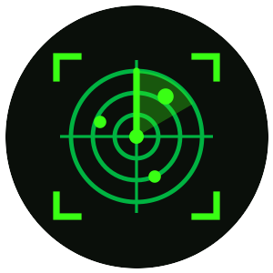
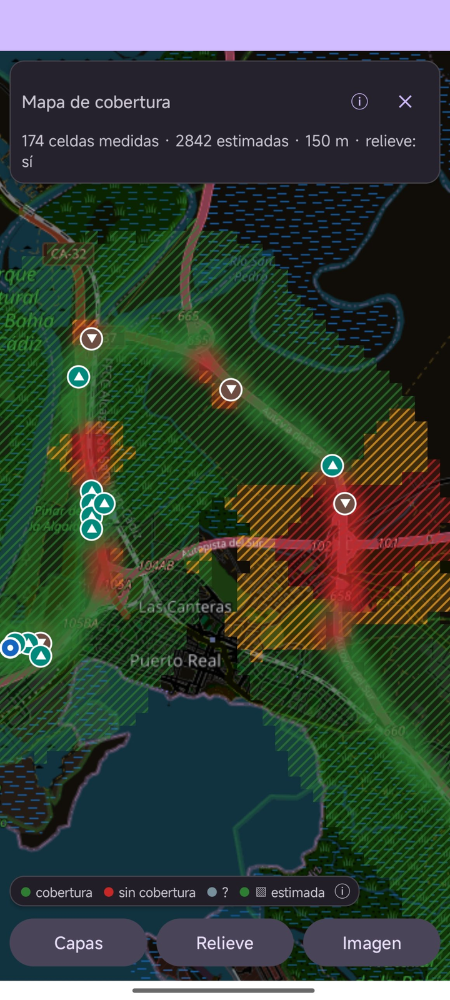
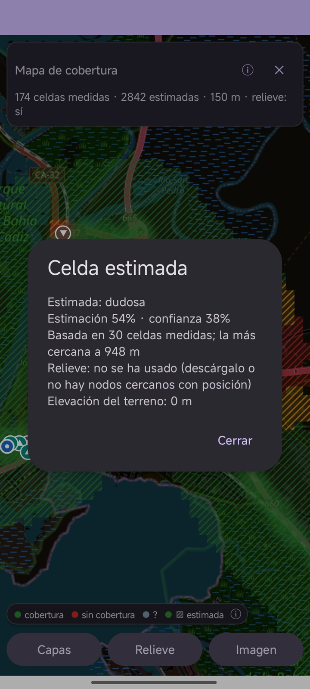
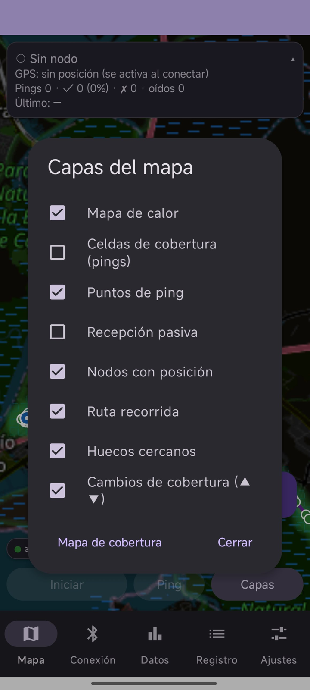
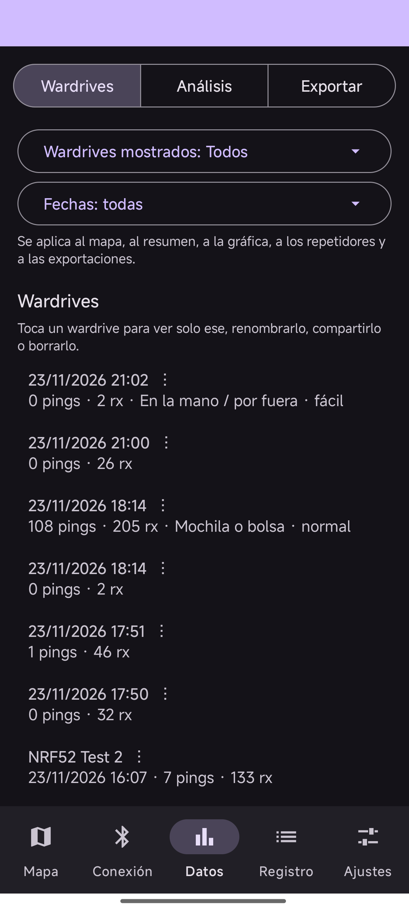
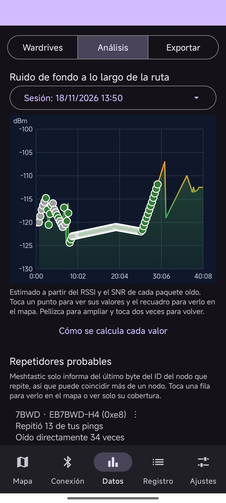
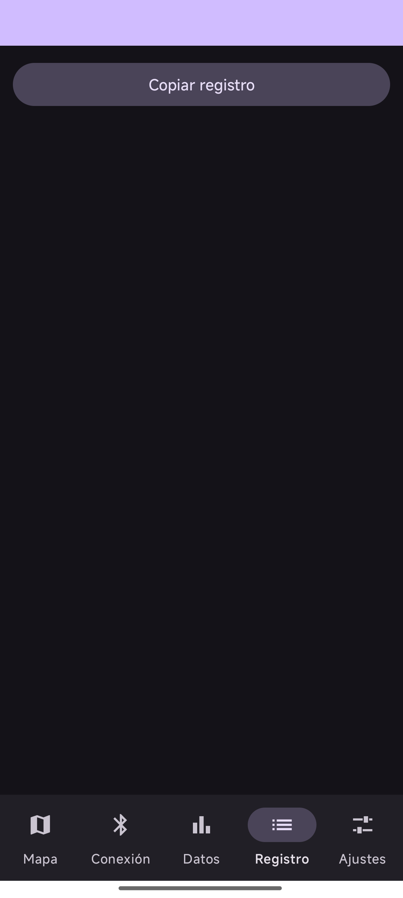

<p align="center"></p>

# MeshWardrive

**English** · [Español](README.es.md)

Android app for mapping the coverage of a **Meshtastic** network while you move (*wardriving*), in the spirit of MeshMapper for MeshCore.

**Author:** EB7BWD

<p align="center">
  
  
  
  
  
</p>
<p align="center">
  
  
  
  
</p>

## Download

Download the APK from **[Releases](../../releases/latest)** and install it (Android 8 or later). That is the **only** official source: don't install copies from other sites, because you can't tell whether they were modified. Every version is signed with the same key, so updates install over the previous one without losing data.

## ⚠️ Important notice

MeshWardrive is an **experimental** app, created by EB7BWD and developed **almost entirely by artificial intelligence** (Claude, by Anthropic). The code has not been audited and may contain errors.

It is provided **"as is", without warranty of any kind**, express or implied, including warranties of operation, data accuracy or fitness for a particular purpose.

By using it you accept that:

- You use it **entirely at your own risk**.
- You are responsible for complying with the law in your country: radio spectrum use, duty cycle and power, data protection and traffic rules.
- Every ping uses airtime on a shared network. It is your responsibility to configure it considerately and not flood the mesh.
- You must not handle the phone while driving.
- Coverage maps are indicative only and must not be relied on for emergency or safety communications.

To the maximum extent permitted by law, **the author accepts no liability** for any damage, loss, penalty, data loss or misuse arising from this app.

If you do not agree, do not use it. The app shows this same notice on first launch and it must be accepted to continue.

## Privacy

**MeshWardrive does not collect any data.** It has no servers or accounts, no analytics or advertising, and sends nothing to the author or to third parties. Your measurements stay on your phone and only leave it if you export or share them.

What does leave the phone:

- **Pings**, which go out over the radio. Anyone with the channel can read them, including your coordinates if you enable "Include coordinates in the message" (off by default).
- **With the online map**, the OpenStreetMap servers receive your IP address and the area you are viewing, as with any web map. With an offline map, they don't.
- **If you download the relief** in the Coverage map, the *Terrain Tiles* server (Amazon Web Services) receives your IP and the area requested. It only happens when you press the button; your position is not sent.

Data from other nodes (names, positions, relays) arrives over the radio and cannot be verified: anyone can fake it. This notice is also in the app, under **Settings → About**.

## What it does

- Connects to your Meshtastic node over Bluetooth.
- Sends periodic pings with ACK to a channel (`wardriving` by default).
- For every ping it stores the GPS position, whether anyone heard it, which node relayed it, and the SNR/RSSI.
- Also logs everything your node hears over the air, with your position.
- Draws it on a map as a heat map: green where there is coverage, red where there is none.
- Before each outing it asks how you carry the node (pocket, car, roof…) and uses those conditions so an area is not marked «no coverage» just because the node was badly placed.
- Marks where coverage has appeared (▲) or been lost (▼) without deleting the history.
- Has a lookup screen, **Coverage map**, with a heat map without points, an estimate for areas not measured yet (which can take the terrain into account) and a sheet for each cell.
- Lists the nodes that probably relayed you.
- Plots the estimated noise floor along the route; tap a point to see it on the map.
- Draws the route travelled and marks unmeasured gaps near you.
- Keeps every wardrive separately: view one, several combined, all, only the latest or those from certain dates, and rename or delete them.
- Lets you delete specific measurements from the map (a ping, a cell or a zone), with undo.
- Builds a report for each outing and compares two wardrives to show where coverage got better or worse.
- Shares wardrives with friends as a `.mwd` file they import into their app.
- Works without Internet using offline maps.
- Exports the result as an image and in formats for building coverage maps.

Besides the normal (channel) mode there is a **direct mode**, where the ping goes to a specific node and its confirmation is recorded, and a **listen-only mode**, which transmits nothing and just records what your node hears.

## Screens

Five tabs, switched by swiping or with the bottom bar: **Map**, **Connection**, **Data**, **Log** and **Settings**. On the map, swiping moves the map; leave that tab with the bottom bar.

- **Map:** the card at the top sums up the connection, GPS and last ping; tap it to fold it. When a ping isn't sent, the reason shows there. Below are **Start/Stop**, **Ping** and **Layers**, plus a legend; **tap the legend** to see what each colour means. **Tap a ping** to see its details and **press and hold** on the map to see that cell's sheet or delete measurements.
- **Data** has three sections: **Wardrives** (choose which are shown, only the latest, date filter, rename, conditions, share, import, delete), **Analysis** (coverage map, summary, report, compare, noise chart, repeaters) and **Export** (image, coverage files, offline maps).
- **Settings** is grouped by topic: Ping, Measurement, Map, Connection, Privacy and Language. Every number has a line underneath explaining what it is for.

**Night mode.** In **Settings → Map → Theme** you can choose light, dark or like the phone (default). In dark the map is darkened too; exported images stay light.

A skippable tutorial is shown the first time; you can see it again from **Settings**.

## Languages

English, Spanish, French, Italian, Portuguese, German, Russian, Arabic, Greek and Japanese. By default it follows the phone's language (English if the phone's isn't one of these). You can change it in **Settings → Language**. Translations were machine-generated and corrections are welcome.

## The `wardriving` channel: a proposed standard

The idea behind this project is that everyone uses **the same channel** for wardriving, so that pings from different people are comparable and anyone can see and log them:

- **Name:** `wardriving`
- **Key (PSK):** `AQ==`

`AQ==` is Meshtastic's default public key. Since everybody knows it, the channel is in practice **unencrypted**: anyone who adds it can read the pings, including your coordinates if you enable "Include coordinates in the message".

This is a proposal, not a requirement. **The choice is ultimately yours:** you can use a private key so only your group sees the pings, or a different channel name (set it in **Settings**). The app works the same either way.

## How to use it

1. Create a secondary channel named `wardriving` with key `AQ==` on your node with the official Meshtastic app (see above).
2. Close the official app (the node accepts only one Bluetooth connection).
3. Open MeshWardrive, accept the notice, go to **Connection**, tap **Scan and connect** and choose your node.
4. In **Map**, tap **Start** and move around.

If the connection fails, the reason is shown in **Connection** and in **Log**. To stop without opening the app, use the **Stop** button in the notification.

## Options

The features that change when pings are sent live in **Settings** and are **off** by default, so the app behaves as before until you decide otherwise. Every option has a line underneath explaining what it does.

| Option | Where | What it does |
|---|---|---|
| Reply wait | Settings → Ping | Seconds to wait for someone to hear the ping (**30** by default; it used to be 90). If the reply arrives when you have already moved more than 75 m, the success is placed where it arrived, not where it was sent, so no green cell appears where there was really no coverage. |
| Ping by speed (SmartBeaconing™) | Settings → Ping | Uses the SmartBeaconing™ algorithm by Tony Arnerich (KD7TA) and Steve Bragg (KA9MVA), from the HamHUD project, the same one used by APRSdroid and many APRS radios: stopped or slow it pings every «slow interval» (120 s); above the «high speed» (90 km/h), every «fast interval» (15 s); in between, proportionally, so pings are spread evenly along the route. Turning more than the set angle sends an extra one. Replaces the fixed interval and never goes below 15 s. Off by default. |
| Criterion for good or bad pings | Settings → Measurement | **Weighted** (default) or **classic**. Explained in [Conditions and criterion](#wardrive-conditions-and-valuation-criterion). |
| Ask the conditions when starting | Settings → Measurement | **On** by default. Pressing Start shows a short sheet with how you carry the node, pre-filled with last time. You can tick «Don’t ask again». |
| Listen-only mode | Settings → Ping → Mode (or the target button in **Connection**) | Sends no pings. Records everything your node hears, with your position. Useful for measuring without using airtime. |
| Ping text | Settings → Ping | The word before the number (`WD` by default, for *wardrive*). Up to 10 letters, digits or `-_#!*+.`. |
| Record everything the node hears | Settings → Measurement | **On** by default. If you turn it off, only what is addressed to you (ACKs and replies) is saved besides the pings: it takes far less space, but the noise chart and the nodes-in-range list get less data. Listen-only mode always records everything. |
| Smart ping | Settings → Measurement | Only sends pings in cells that do not yet have enough measurements **with a reply** (3 by default); failures don’t count, so a cell without coverage is tried again on another outing. Saves airtime when you repeat routes. Two more settings: **attempts without reply per cell in each outing** (3; so it does not insist forever in a dead zone, 0 = no limit) and **minimum distance between measurements in a cell** (0 = off; spreads measurements instead of piling them up at a traffic light). |
| Pause when the channel is busy | Settings → Measurement | If the node reports channel utilization above the threshold (25 % by default), pings stop until it drops. Current utilization is shown on the map card. |
| Node GPS | Settings → Measurement | If your node has GPS, its position is used when the phone's is missing or not accurate enough. Its age is computed from the time of the fix itself (not when it arrived) and positions up to 1 minute old are accepted. If the channel trims the precision (*precision bits*), that error is added. **Log** shows every position received from the node with its accuracy and age, or why it was not used. See [Setting up the node's GPS](#setting-up-the-nodes-gps). |
| Stop reconnecting | Settings → Connection | If the node has been disconnected for longer than this (10 min by default), the wardrive stops and a notification tells you. 0 = never give up. |
| Theme | Settings → Map | Like the phone (default), light or dark (night). |
| Your name when sharing | Settings → Privacy | The name shown in `.mwd` files. If empty, your node's name is used. |

Under **Layers** (Map tab) you can turn on or off the heat map, cells, pings, passive reception, nodes, the **route travelled**, **nearby gaps** (unmeasured neighbouring cells, so you know where to go next) and **coverage changes** (▲ ▼). The **Coverage map** opens from the same dialog.

## Wardrive conditions and valuation criterion

Getting no reply with the node in your pocket is not the same as with an antenna on the car roof. So when you press **Start**, the app asks in a short sheet:

- **Where the node is:** pocket, backpack, in hand, inside the car, dashboard, car roof or mast.
- **External antenna** and its gain (dBi).
- **Transmit power** (dBm). If the node reports it, it is filled in automatically.
- **How you move:** walking, bike or car.

From that it works out a **difficulty** (easy, normal or hard), shown on the same sheet while you fill it in, and a **reliability** for that outing's failures. The conditions are stored with each wardrive, can be corrected later (**Data → Wardrives →** tap a wardrive **→ Conditions…**) and travel inside the `.mwd` file. Old wardrives without conditions are treated as medium reliability and look the same as before.

**Weighted criterion** (default, in **Settings → Measurement**):
- A reply always proves there is coverage.
- A failure only counts as «no coverage» if the conditions were reasonable. Failures with hard conditions are drawn in **grey-blue** («unconfirmed») and hide nothing.
- Each cell takes the state of its **latest outing with conclusive data**. If there used to be no coverage and now there is, it is marked **▲**; if there used to be and now there isn't, **▼**. History is not deleted: old failures in an area that now has coverage show as **hollow dots**.

**Classic criterion:** every ping counts the same, as in earlier versions. A cell is green if it ever had a reply and red if never.

## Coverage map and estimate

**Data → Analysis → Coverage map** (or from **Layers**) opens a lookup screen, meant for looking at coverage rather than measuring:

- **Measured:** heat map without points, with the same colours as the main map.
- **Estimate (hatched):** where you have not measured, the app estimates coverage from nearby measured cells (up to 2 km). It is always hatched so it is never mistaken for real data, and low-confidence cells are not drawn.
- **Relief:** the **Relief** button downloads the terrain elevation for the visible area (open *Terrain Tiles* data, about 30 m per pixel; at most 80 tiles per download) and then works offline. With the relief, the estimate checks whether a hill blocks the view to the nodes that heard you: a clear view raises the probability and a blocked one halves it.
- **Cell sheet:** tap any cell to see whether it is measured or estimated, its state, the SNR range, when it was first and last measured (and whether the data is old), the reliability of the measurements, the average GPS altitude, the terrain elevation and which nodes heard or relayed you there.
- **Image:** exports what you see as a PNG.

The estimate is only a guide: it ignores buildings and vegetation, and antenna heights are assumed (1.5 m for you, 5 m for the node).

## Deleting measurements

Sometimes a measurement is wrong: the node was in the glovebox, the GPS jumped, or you ran a test at home. To remove it without deleting the whole wardrive:

- **One ping:** tap it on the map and press **Delete this measurement**.
- **One cell:** press and hold on it; its sheet opens. Press **Delete… → Measurements in this cell**.
- **A zone:** press and hold on one corner, press **Delete… → A zone: this is one corner**, then press and hold on the opposite corner. Before deleting, the app shows how many measurements are inside.

Only the wardrives currently shown are affected. After deleting, a notice with **Undo** stays for a few seconds; nothing is really deleted until it disappears.

## Viewing by dates

In **Data → Wardrives**:
- The **Dates** button lets you see everything, everything **up to** a date, or just an **interval**. When a date filter is active it is shown above the map; tap the ✕ to clear it.
- When choosing which wardrives are shown, the **Only the latest** button unticks all the others at once.

## Pings that aren't sent and duty cycle

If it is **your own node** that fails to transmit the ping (for example because it has used up the allowed **duty cycle** in the band, error `DUTY_CYCLE_LIMIT`), the app marks it as **not sent**, in grey. It does not count as «no coverage», because nobody had the chance to hear it. If the reason is the duty cycle, automatic pings pause for 5 minutes and the map card says until when.

In Europe (868 MHz) the usual limit is 10 % of the time per hour in the sub-band Meshtastic uses. With intervals of 30 s or more and few hops it is rarely reached, but with slow presets it can be.

## Node role

If you connect a node with a **repeater** role (ROUTER, ROUTER_LATE, REPEATER…), the app warns you in **Connection** and **Log**: a node you carry around repeating traffic uses the mesh's airtime and can distort the measurement. For wardriving the **CLIENT_MUTE** role (the node sends and receives but repeats nothing) or **CLIENT** is recommended. Change it in the official Meshtastic app, under *Settings → Device → Role*.

## Setting up the node's GPS

Many GPS trackers (for example a RAK WisMesh Tag) send their position rarely and sometimes without accuracy, so the app may not accept it. In the official Meshtastic app, under *Settings → Position*:

- **GPS update interval:** 2 minutes by default. Lower it to 10–30 s while wardriving (uses more battery).
- **Smart broadcast:** turn it on, with a small minimum distance (for example 50–100 m) and a short minimum interval.
- **Position precision on the channel** (*precision bits*): if the channel the position arrives on trims it, the app cannot know where you are more precisely than that. With 32 bits it is complete; with low values the error is hundreds of metres or kilometres, and the app will discard it if it exceeds the minimum accuracy.

If the node reports no accuracy, the app marks it as **unknown** (±?) and uses it like any other: only when the phone's position is missing or not accurate enough. **Log** shows every node position and why it was used or not.

## Storage and backups

Pings and the route take very little space and have no limit. What can grow a lot is **passive reception** (everything your node hears): on a busy mesh that is thousands of packets per outing, and with listen-only mode running for hours it fills up sooner. So the app keeps at most **300,000 packets** (a few tens of MB); beyond that it deletes the oldest.

Before that happens, it warns you:
- **Data → Wardrives** always shows how many received packets are stored and the percentage of the limit.
- At **80 %** and **95 %** the app shows a warning (and a notification if you are wardriving) with three choices: manage wardrives, stop recording passive traffic, or remind you later.
- When importing a `.mwd` that would go over the limit, the summary tells you how many old packets would be deleted, before you accept.

To make a **backup**, share your wardrives as `.mwd` and save the file (to Drive, your computer…). Untick "Trim 1 km" so the copy is complete. You can then delete those wardrives from the phone and import them again whenever you like.

## Managing and sharing wardrives

In **Data → Wardrives**, tap any wardrive to show only that one on the map, rename it, share it or delete it. The checkboxes choose which ones are shown together.

**Share.** **Share wardrives…** builds a `.mwd` file with the wardrives you choose and opens Android's share menu. Before that it lets you:
- **Trim 1 km at the start and end** (on by default), since those are usually your home or workplace.
- **Remove coordinates from the ping text.**

The file contains your route with times: check what you share and with whom.

**Import.** Open the `.mwd` with MeshWardrive (from a chat or a file manager) or use **Import wardrive…**. A summary is shown before importing. The importer is built not to trust the file: it limits its size, only accepts known fields with values in range, drops anything that doesn't fit, and rejects the whole file if there is too much junk. Imported text is never interpreted as code or as a formula. Imported wardrives carry the sharer's name and can be viewed, compared or deleted like your own.

## Analysis

In **Data → Analysis**:

- **Report:** distance, duration, pings and share answered, cells measured and covered, and the best and worst area (tap them to go to the map). **Share image** creates an image with the map and the summary.
- **Compare:** choose a "before" group of wardrives and an "after" group. The map colours each cell by whether it got better, worse, stayed the same, is new or was only measured before. Useful to see the effect of a new repeater or an antenna change. A cell counts as changed if its success rate moves by 15 points or its best SNR by 3 dB.
- **Noise chart:** tap a point to see its time, noise, RSSI, SNR and status; tap the box to see it on the map. Pinch to zoom, double-tap to reset. Several wardrives are drawn one after another, separated by a dashed line.
- **Repeaters:** tap one to see it on the map or show **only its coverage** (the pings it relayed) and its maximum range.
- **How each value is calculated:** the same explanation as below, inside the app.

## How each value is calculated

**Pings**

| Value | How it is obtained |
|---|---|
| Heard by the mesh | Your node heard a neighbour rebroadcast the ping (Meshtastic's implicit ACK). |
| ACK from target | Direct mode only: the target node sent back a real acknowledgement. |
| Rejected / nobody listening | The node reported an error. The usual one is `MAX_RETRANSMIT`: it retried and nobody rebroadcast. |
| No response | Nothing arrived within the maximum wait (30 s by default). |
| Not sent | Your own node did not transmit the ping (duty cycle used up, queue full, no channel…). It counts in no percentage and not as «no coverage». |
| Late reply | If the reply arrives when you are more than 75 m from where the ping was sent, the success is placed where it arrived. The ping's details say so. |
| Relay | The `relay_node` field of the acknowledgement: the last byte of the ID of the node that rebroadcast. The app lists every known node whose ID ends in that byte. |
| Relay SNR / RSSI | Measured by **your** node when it heard that rebroadcast. They describe the path from the relay to you, not how well the relay heard you. |
| ACK SNR / RSSI | Direct mode: measured by your node on the last hop of the acknowledgement. |
| Hops | `hop_start − hop_limit` of the packet received. |
| Latency | Time between sending the ping and receiving its response. |
| Success % | Answered ÷ (answered + unanswered). Pings still waiting and pings not sent are not counted. |

A ping is sent automatically only when the minimum interval has passed (or the one set by ping by speed), you have moved the minimum distance, the GPS fix is recent and accurate enough, and the previous ping has finished. The default hop limit is 1: only direct neighbours rebroadcast it.

**Map**

| Value | How it is obtained |
|---|---|
| Colour | By SNR: green ≥ −7 dB, amber from −7 to −13 dB, orange below −13 dB. Red means no response. A ping heard without an SNR value is green. |
| Heat map | One blurred spot per ping, in its colour, with a radius equal to the cell size (never smaller than a fingertip on screen). Failures are drawn first and successes on top. |
| Cells | A grid of squares of the configured size (150 m by default). If the cell has coverage, the colour is that of the **best** SNR among the answered pings. With the weighted criterion, the state (coverage, no coverage or unconfirmed) is decided by the latest outing with conclusive data; with the classic one, it is green if there was ever a reply and red if never. |
| Difficulty of the conditions | dB compared with the reference (stock 2 dBi antenna outside the vehicle, 22 dBm): pocket −15, backpack −10, in hand −3, inside the car −8, dashboard −5, roof 0, mast +3; plus external antenna gain − 2 and power − 22. From −3 it is easy (high reliability), from −10 normal (medium) and below that hard (low). |
| Unconfirmed | A cell with only low-reliability failures. Weighted criterion only. |
| ▲ / ▼ | ▲: the latest conclusive outing had a reply and an earlier one only failures. ▼: the latest had no reply and an earlier one did. |
| Cell average SNR | Arithmetic mean of the SNR of the answered pings in the cell. |
| Passive reception | Every packet your node receives over the radio (not via MQTT), stored with your position at that moment, if the GPS fix is under 15 s old. |

**Analysis**

| Value | How it is obtained |
|---|---|
| Noise floor | Meshtastic does not report it, so it is an estimate from each packet heard: `RSSI − SNR` when the SNR is positive, and the `RSSI` itself when the SNR is negative (the signal is then below the noise). Packets with an SNR above 5 dB are left out, because LoRa's SNR saturates and the subtraction would give a false, much higher noise. There are only values where something was received. |
| Ping markers on the chart | Placed at the time of each ping, on the noise line (interpolated between the nearest samples). |
| Probable repeaters | If the firmware reports who relayed each ping, pings grouped by relay byte. Many firmware versions do not report it; the list then shows the nodes within range: those heard directly (with their full ID) and those seen relaying other traffic. "Other packets" counts third-party traffic that reached you through that same byte. Best and average SNR come from those receptions. |
| Repeater position on the map | The node's own position if exactly one known node matches and it has shared it; otherwise the place where it was heard best. |
| Estimate | Average of measured cells within 2 km, weighted by inverse distance (coverage 1 / 0.8 / 0.6 by SNR; no coverage 0). Confidence drops with the distance to the nearest measured cell and rises with the number of neighbours; below 30 % it is not drawn. Likely from 60 %, uncertain from 35 %. |
| Relief | Line of sight from the cell (1.5 m above ground) to each node with a position that heard you (5 m), accounting for the Earth's curvature and part of the Fresnel zone. Clear: +20 points; blocked: the estimate is halved. |

## Offline maps

The OpenStreetMap tile servers do not allow downloading areas for offline use, so the app uses Mapsforge vector maps, which are made for it:

1. Download the `.map` file for your area, for example from <https://download.mapsforge.org/>.
2. In **Data → Export → Offline map… → Import map**, choose the file.
3. The app copies it and starts using it. From the same menu you can go back to the online map or delete it.

## Export

From the **Data** tab:

| Format | Use |
|---|---|
| PNG image | The map as shown, with legend and summary. For sharing. |
| Cells GeoJSON | Coverage polygons with statistics and colour. For QGIS, uMap, geojson.io. |
| KML | Cells, pings and nodes in folders. For Google Earth and OsmAnd. |
| Points GeoJSON | Every ping and every packet heard, with all its data. |
| CSV | Pings and passive reception as tables. For spreadsheets. |

### How to use each export

Exports are under **Data → Export** and include only the wardrives currently shown. They contain your route: check them before sharing. To pass wardrives to someone else who uses MeshWardrive, the `.mwd` file is better (see above).

**PNG image.** A picture of the map as you see it at that moment, so first set the zoom and the layers you want. Share it by chat or social media, or paste it into a document.

**Cells GeoJSON** (`coverage-cells-….geojson`). The coverage map ready to publish.
- *geojson.io*: open the site and drag the file onto the map. The cells appear already coloured.
- *uMap*: create a map, then **Import data** and choose the file. Useful for a shareable online map.
- *QGIS*: drag the file into the window. Colour it by the `class` field (`good`, `marginal`, `weak`, `no_coverage`, `unconfirmed`) or by `success_pct`.
- Fields per cell: `pings`, `ok`, `fail`, `unconfirmed_fail`, `success_pct`, `best_snr`, `avg_snr`, `trend` (`new_coverage`, `lost_coverage`), `first` and `last` (dates of the first and last measurement). Cells with `layer` = `rx` are passive reception.

**KML** (`coverage-….kml`). For viewing on a globe or in a navigation app.
- *Google Earth*: on a computer, **File → Import KML file**; on a phone, open the file with Google Earth.
- *OsmAnd*: open the file with OsmAnd, or import it as a favourite/track.
- It has four folders you can switch on and off: coverage cells, pings, passive reception and nodes. Tap any item to see its details.

**Points GeoJSON** (`wardrive-….geojson`). Every single measurement, for your own analysis.
- *QGIS* or *kepler.gl*: load the file and colour the points by `status`, `relay_snr` or `snr`.
- The `kind` field separates pings (`ping`) from packets heard (`rx`).
- Use it if you want a different grid or your own heat map.

**CSV** (`wardrive-pings-….csv` and `wardrive-rx-….csv`). Tables for spreadsheets and scripts.
- Open them with LibreOffice Calc or Excel (comma separator, UTF-8).
- Pings: one row per ping, with time, position, status, error, latency, relay and SNR/RSSI.
- Passive reception: one row per packet heard, with origin node, port, SNR, RSSI, hops and relay.

## Build

Only needed if you want to modify the app; to use it, download the APK from **Releases**.

With Android Studio or locally:

```bash
./gradlew assembleDebug
```

With GitHub Actions, every *push* builds the signed APK, available under **Actions → Artifacts**, and every `v*` tag (for example `v0.7.0`) also publishes a release with the APK and the notes from `docs/release-notes/<tag>.md`. Signing uses two repository secrets, `KEYSTORE_BASE64` (the keystore in base64) and `KEYSTORE_PASSWORD`, with alias `meshwardrive`. The key must never be committed to the repository.

## Airtime

Keep the interval at 30 s or more and the `hop_limit` low. Smart ping and ping by speed help avoid spending airtime where there is already data or while you are stopped.

## Support the project

MeshWardrive is free, ad-free and will stay that way. If you find it useful and want to help with the costs, you can buy me a coffee on Ko-fi:

[](https://ko-fi.com/eb7bwd)

It is entirely voluntary: the app has no paid features and never will. Reporting bugs, suggesting improvements or reviewing translations helps a lot too.

## License

Copyright © 2026 EB7BWD

Free software under the [GNU General Public License v3.0](LICENSE) or later. You may use, modify and redistribute it, provided derived versions remain free under the same license. It is distributed **without any warranty**.

## Credits

- Idea and project: **EB7BWD**
- Code generated almost entirely with AI (Claude, by Anthropic)
- Maps © OpenStreetMap contributors
- Relief: Terrain Tiles (AWS Open Data; sources SRTM, NED, ETOPO1 and others)
- Ping by speed: SmartBeaconing™ algorithm, invented by Tony Arnerich (KD7TA) and Steve Bragg (KA9MVA) for the HamHUD project. SmartBeaconing is a trademark of HamHUD Nichetronix.
- osmdroid, AndroidX, Material Components and kotlinx.coroutines (Apache 2.0); Mapsforge (LGPL v3)

Independent project, not affiliated with Meshtastic, MeshMapper or HamHUD Nichetronix. Meshtastic® is a registered trademark of Meshtastic LLC. SmartBeaconing™ is a trademark of HamHUD Nichetronix.
