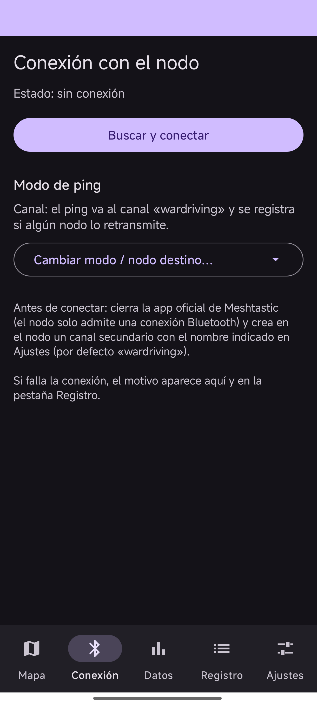
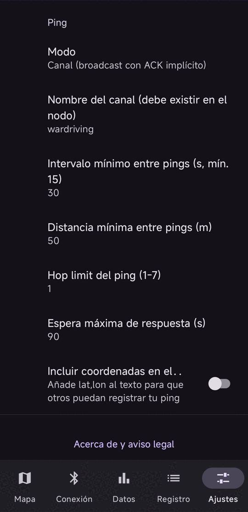

<p align="center"></p>

# MeshWardrive

**English** · [Español](README.es.md)

Android app for mapping the coverage of a **Meshtastic** network while you move (*wardriving*), in the spirit of MeshMapper for MeshCore.

**Author:** EB7BWD

<p align="center">
  
  
  
  
  
  
</p>

## ⚠️ Important notice

MeshWardrive is an **experimental** app, created by EB7BWD and developed **almost entirely by artificial intelligence** (Claude, by Anthropic). The code has not been audited and may contain errors.

It is provided **"as is", without warranty of any kind**, express or implied, including warranties of operation, data accuracy or fitness for a particular purpose.

By using it you accept that:

- You use it **entirely at your own risk**.
- You are responsible for complying with the law in your country: radio spectrum use, duty cycle and power, data protection and traffic rules.
- Every ping uses airtime on a shared network. It is your responsibility to configure it considerately and not flood the mesh.
- You must not handle the phone while driving.
- Coverage maps are indicative only and must not be relied on for emergency or safety communications.

To the maximum extent permitted by law, **the author accepts no liability** for any damage, loss, penalty, data loss or misuse arising from this app.

If you do not agree, do not use it. The app shows this same notice on first launch and it must be accepted to continue.

## What it does

- Connects to your Meshtastic node over Bluetooth.
- Sends periodic pings with ACK to a channel (`wardriving` by default).
- For every ping it stores the GPS position, whether anyone heard it, which node relayed it, and the SNR/RSSI.
- Also logs everything your node hears over the air, with your position.
- Draws it on a map as a heat map: green where there is coverage, red where there is none.
- Lists the nodes that probably relayed you.
- Plots the estimated noise floor along the route; tap a point to see it on the map.
- Keeps every wardrive separately: view one, several combined, or all of them.
- Works without Internet using offline maps.
- Exports the result as an image and in formats for building coverage maps.

There is also an optional direct mode: the ping goes to a specific node and its confirmation is recorded.

## Screens

Five tabs, switched by swiping or with the bottom bar: **Map**, **Connection**, **Data**, **Log** and **Settings**. On the map, swiping moves the map; leave that tab with the bottom bar.

## Languages

English, Spanish, French, Italian, Portuguese, German, Russian, Arabic, Greek and Japanese. The app follows the phone's language; on Android 13 or later you can also choose it per app in the system settings. Translations were machine-generated and corrections are welcome.

## The `wardriving` channel: a proposed standard

The idea behind this project is that everyone uses **the same channel** for wardriving, so that pings from different people are comparable and anyone can see and log them:

- **Name:** `wardriving`
- **Key (PSK):** `AQ==`

`AQ==` is Meshtastic's default public key, the same one the standard LongFast channel uses. Since everybody knows it, the channel is in practice **unencrypted**: anyone who adds it can read the pings, including your coordinates if you enable "Include coordinates in the message".

This is a proposal, not a requirement. **The choice is ultimately yours:** you can use a private key so only your group sees the pings, or a different channel name (set it in **Settings**). The app works the same either way.

## How to use it

1. Create a secondary channel named `wardriving` with key `AQ==` on your node with the official Meshtastic app (see above).
2. Close the official app (the node accepts only one Bluetooth connection).
3. Open MeshWardrive, accept the notice, go to **Connection**, tap **Scan and connect** and choose your node.
4. In **Map**, tap **Start** and move around.

If the connection fails, the reason is shown in **Connection** and in **Log**.

## How each value is calculated

**Pings**

| Value | How it is obtained |
|---|---|
| Heard by the mesh | Your node heard a neighbour rebroadcast the ping (Meshtastic's implicit ACK). |
| ACK from target | Direct mode only: the target node sent back a real acknowledgement. |
| Rejected / nobody listening | The node reported an error. The usual one is `MAX_RETRANSMIT`: it retried and nobody rebroadcast. |
| No response | Nothing arrived within the maximum wait (90 s by default). |
| Relay | The `relay_node` field of the acknowledgement: the last byte of the ID of the node that rebroadcast. The app lists every known node whose ID ends in that byte. |
| Relay SNR / RSSI | Measured by **your** node when it heard that rebroadcast. They describe the path from the relay to you, not how well the relay heard you. |
| ACK SNR / RSSI | Direct mode: measured by your node on the last hop of the acknowledgement. |
| Hops | `hop_start − hop_limit` of the packet received. |
| Latency | Time between sending the ping and receiving its response. |
| Success % | Answered ÷ (answered + unanswered). Pings still waiting are not counted. |

A ping is sent automatically only when the minimum interval has passed, you have moved the minimum distance, the GPS fix is recent and accurate enough, and the previous ping has finished. The default hop limit is 1: only direct neighbours rebroadcast it.

**Map**

| Value | How it is obtained |
|---|---|
| Colour | By SNR: green ≥ −7 dB, amber from −7 to −13 dB, orange below −13 dB. Red means no response. A ping heard without an SNR value is green. |
| Heat map | One blurred spot per ping, in its colour, with a radius equal to the cell size (never smaller than a fingertip on screen). Failures are drawn first and successes on top. |
| Cells | A grid of squares of the configured size (150 m by default). The colour is that of the **best** SNR among the answered pings in the cell; red if none was answered. |
| Cell average SNR | Arithmetic mean of the SNR of the answered pings in the cell. |
| Passive reception | Every packet your node receives over the radio (not via MQTT), stored with your position at that moment, if the GPS fix is under 15 s old. |

**Analysis**

| Value | How it is obtained |
|---|---|
| Noise floor | Meshtastic does not report it, so it is an estimate from each packet heard: `RSSI − SNR` when the SNR is positive, and the `RSSI` itself when the SNR is negative (the signal is then below the noise). Packets with an SNR above 5 dB are left out, because LoRa's SNR saturates and the subtraction would give a false, much higher noise. There are only values where something was received. |
| Ping markers on the chart | Placed at the time of each ping, on the noise line (interpolated between the nearest samples). |
| Probable repeaters | If the firmware reports who relayed each ping, pings grouped by relay byte. Many firmware versions do not report it; the list then shows the nodes within range: those heard directly (with their full ID) and those seen relaying other traffic. "Other packets" counts third-party traffic that reached you through that same byte. Best and average SNR come from those receptions. |
| Repeater position on the map | The node's own position if exactly one known node matches and it has shared it; otherwise the place where it was heard best. |

## Offline maps

The OpenStreetMap tile servers do not allow downloading areas for offline use, so the app uses Mapsforge vector maps, which are made for it:

1. Download the `.map` file for your area, for example from <https://download.mapsforge.org/>.
2. In **Data → Offline map… → Import map**, choose the file.
3. The app copies it and starts using it. From the same menu you can go back to the online map or delete it.

## Export

From the **Data** tab:

| Format | Use |
|---|---|
| PNG image | The map as shown, with legend and summary. For sharing. |
| Cells GeoJSON | Coverage polygons with statistics and colour. For QGIS, uMap, geojson.io. |
| KML | Cells, pings and nodes in folders. For Google Earth and OsmAnd. |
| Points GeoJSON | Every ping and every packet heard, with all its data. |
| CSV | Pings and passive reception as tables. For spreadsheets. |

### How to use each export

All exports include only the wardrives selected in **Wardrives shown**.

**PNG image.** A picture of the map as you see it at that moment, so first set the zoom and the layers you want. Share it by chat or social media, or paste it into a document.

**Cells GeoJSON** (`coverage-cells-….geojson`). The coverage map ready to publish.
- *geojson.io*: open the site and drag the file onto the map. The cells appear already coloured.
- *uMap*: create a map, then **Import data** and choose the file. Useful for a shareable online map.
- *QGIS*: drag the file into the window. Colour it by the `class` field (`good`, `marginal`, `weak`, `no_coverage`) or by `success_pct`.
- Fields per cell: `pings`, `ok`, `fail`, `success_pct`, `best_snr`, `avg_snr`. Cells with `layer` = `rx` are passive reception.

**KML** (`coverage-….kml`). For viewing on a globe or in a navigation app.
- *Google Earth*: on a computer, **File → Import KML file**; on a phone, open the file with Google Earth.
- *OsmAnd*: open the file with OsmAnd, or import it as a favourite/track.
- It has four folders you can switch on and off: coverage cells, pings, passive reception and nodes. Tap any item to see its details.

**Points GeoJSON** (`wardrive-….geojson`). Every single measurement, for your own analysis.
- *QGIS* or *kepler.gl*: load the file and colour the points by `status`, `relay_snr` or `snr`.
- The `kind` field separates pings (`ping`) from packets heard (`rx`).
- Use it if you want a different grid or your own heat map.

**CSV** (`wardrive-pings-….csv` and `wardrive-rx-….csv`). Tables for spreadsheets and scripts.
- Open them with LibreOffice Calc or Excel (comma separator, UTF-8).
- Pings: one row per ping, with time, position, status, error, latency, relay and SNR/RSSI.
- Passive reception: one row per packet heard, with origin node, port, SNR, RSSI, hops and relay.

## Build

With Android Studio, or with GitHub Actions: every *push* builds the APK, available under **Actions → Artifacts**.

```bash
./gradlew assembleDebug
```

## Airtime

Keep the interval at 30 s or more and the `hop_limit` low.

## License

Copyright © 2026 EB7BWD

Free software under the [GNU General Public License v3.0](LICENSE) or later. You may use, modify and redistribute it, provided derived versions remain free under the same license. It is distributed **without any warranty**.

## Credits

- Idea and project: **EB7BWD**
- Code generated almost entirely with AI (Claude, by Anthropic)
- Maps © OpenStreetMap contributors
- osmdroid, AndroidX, Material Components and kotlinx.coroutines (Apache 2.0); Mapsforge (LGPL v3)

Independent project, not affiliated with Meshtastic or MeshMapper. Meshtastic® is a registered trademark of Meshtastic LLC.
